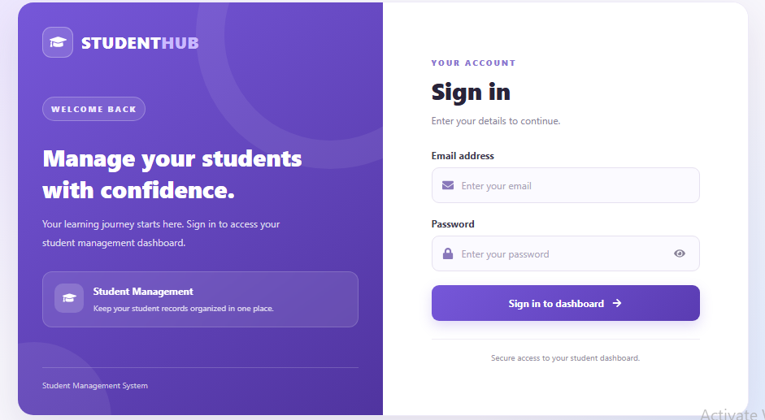
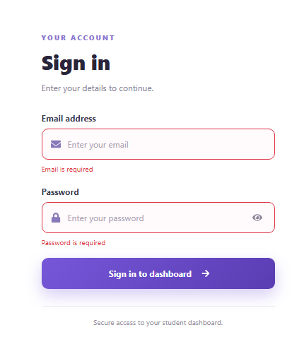
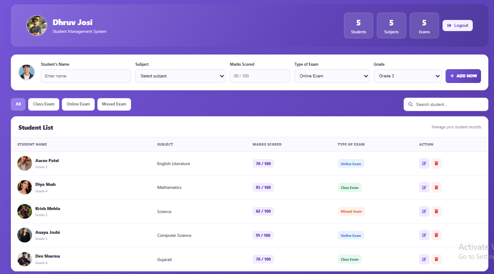
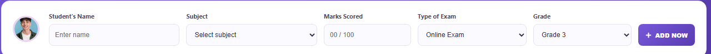
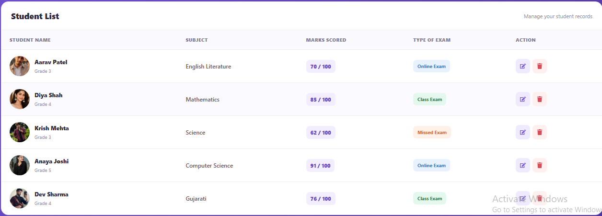
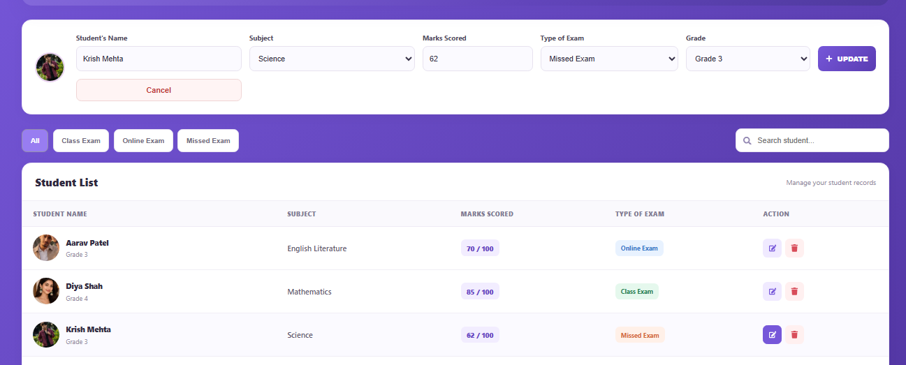
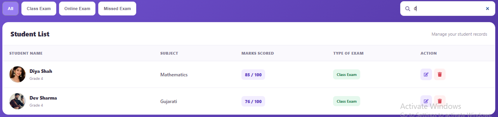
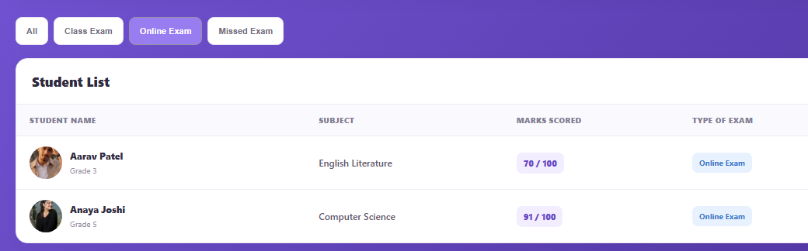

# Student Management System

A student management web application built with **React**, **Plain
Redux**, **React-Redux**, **React Router DOM**, **Axios**,
**Bootstrap**, **React Icons**, and **JSON Server**.

> This project uses plain Redux and React-Redux. It does **not** use
> Redux Toolkit or Redux Thunk.

## Screenshots

Place your actual screenshots in a `screenshots/` folder in the project
root, using the filenames below.

### Login Page



### Validation



### Dashboard



### Form



### Student List



### Upadate Student



### Searching Student



### Sorting Student




To add screenshots: 1. Run the application and open each page. 2. Take
screenshots. 3. Create a `screenshots` folder beside `src` and
`db.json`. 4. Save the files as `login.png`, `dashboard.png`,
`add-student.png`, `student-list.png`, and `edit-student.png`. 5. Commit
and push the screenshots folder. The images will then render on GitHub.

## Features

### Authentication

-   Login using email and password.
-   Validate credentials against the `users` collection in JSON Server.
-   Keep login information in local storage as implemented by the app.
-   Protect the dashboard route.
-   Navigate to the dashboard after successful login.
-   Logout.
-   No registration page.

### Student Management

-   Fetch and display student records.
-   Add, edit, update, and delete students.
-   Search by student name or subject.
-   Filter by exam type.
-   Show name, subject, marks, exam type, grade, and image.
-   Use a default image when a student record has no custom image.

### Interface

-   Bootstrap-based layout.
-   React Icons.
-   Form validation for required fields and marks.
-   Dashboard student details and summary.

## Tech Stack

  Technology         Purpose
  ------------------ -----------------------------------
  React              User interface
  Vite               Development server and build tool
  Redux              Central application state
  React-Redux        Connect React components to Redux
  React Router DOM   Routing and protected routes
  Axios              HTTP requests
  JSON Server        Local REST API and data storage
  Bootstrap          Styling and layout utilities
  React Icons        Interface icons

## Folder Structure

``` text
student-management-system/
├── public/
|
├── src/
│   ├── assets/
|        └── yash.jpg
|        |── diya.jpg
|        |── dev.jpg
|        |── dhruv.jpg
|        |── anaya.jpg
|        └── krish.jpg
|
|   ├── screenshots/
│       ├── login.png
│       ├── dashboard.png
│       ├── searching.png
│       ├── list.png
│       └── update.png
│       ├── sorting.png
│       └── form.png
│       └── validation.png
|   | 
│   ├── components/
│   │   ├── authentication/
│   │   │   ├── Login.jsx
│   │   │   ├── ProtectedRoute.jsx
│   │   │   └── validation.js
│   │   └── students/
│   │       ├── Dashboard.jsx
│   │       ├── StudentForm.jsx
│   │       ├── StudentList.jsx
│   │       ├── StudentDetails.jsx
│   │       ├── StudentSearch.jsx
│   │       └── studentService.js
│   ├── redux/
│   │   ├── action/
│   │   │   ├── authActions.js
│   │   │   └── studentActions.js
│   │   ├── reducer/
│   │   │   ├── authReducer.js
│   │   │   └── studentReducer.js
│   │   └── store/
│   │       └── store.js
│   ├── App.jsx
│   ├── App.css
│   └── main.jsx
├── db.json
├── index.html
├── package.json
└── README.md
```

> Keep this tree aligned with your actual project files if you have used
> slightly different filenames or folders.

## Complete Application Workflow

### 1. Run the backend API

-   JSON Server reads `db.json`.
-   `users` stores the demo login accounts.
-   `students` stores student records.
-   API base URL: `http://localhost:3000`.

### 2. Login workflow

1.  The user enters an email and password on `Login.jsx`.
2.  The authentication logic requests the user list from JSON Server
    using Axios.
3.  The entered credentials are checked against the returned users.
4.  If the credentials match, `loginSuccess` is dispatched to Redux.
5.  The app stores the configured login information in local storage and
    navigates to `/dashboard`.
6.  If the credentials do not match, an error message is shown.

### 3. Protected route workflow

1.  The user opens `/dashboard`.
2.  `ProtectedRoute.jsx` checks the authentication state.
3.  Authenticated users can access the dashboard.
4.  Unauthenticated users are redirected to `/login`.

### 4. Load students

1.  `Dashboard.jsx` calls the student service.
2.  `studentService.js` makes an Axios GET request to `/students`.
3.  Student data is dispatched through the student actions.
4.  `studentReducer.js` updates the Redux state.
5.  The dashboard and student list re-render with the updated data.

### 5. Add a student

1.  The user completes the student form.
2.  The form creates an object with name, subject, marks, exam type,
    grade, and image.
3.  The dashboard calls the add-student service.
4.  Axios sends a POST request to `/students`.
5.  The response is dispatched to Redux and the new student appears in
    the list.

### 6. Edit a student

1.  The user clicks Edit on a student row.
2.  The selected student's values are loaded into `StudentForm.jsx`.
3.  The user changes the fields and submits the form.
4.  Axios sends a PUT request to `/students/:id`.
5.  Redux updates the record shown on the dashboard.

### 7. Search and filter

-   Search checks student name or subject.
-   The exam-type filter can show all students or only the selected exam
    type.
-   The visible list updates according to the selected search/filter
    values.

### 8. Delete a student

1.  The user clicks Delete.
2.  The dashboard calls the delete-student service.
3.  Axios sends a DELETE request to `/students/:id`.
4.  Redux removes the student from the displayed list.

### 9. Logout

1.  The user clicks Logout in the navigation bar.
2.  The app clears the login data according to its logout logic.
3.  The user returns to the login page.
4.  The protected dashboard requires login again.

## Data Structure

`db.json` should contain top-level `users` and `students` arrays.
Example:

``` json
{
  "users": [
    {
      "id": "1",
      "name": "Yasin Mithani",
      "email": "yasin@gmail.com",
      "password": "yasin123"
    }
  ],
  "students": [
    {
      "id": "1",
      "name": "Aarav Patel",
      "subject": "English Literature",
      "marks": 70,
      "examType": "Online Exam",
      "grade": "Grade 3",
      "image": ""
    }
  ]
}
```

This is an example shape; keep the actual records in your existing
`db.json`. JSON Server can generate IDs for new records when an ID is
omitted.

## Setup and Run

### Requirements

-   Node.js and npm.

### 1. Install packages

``` bash
npm install
```

If required packages are not already present in `package.json`, install
them:

``` bash
npm install axios bootstrap react-icons react-redux redux react-router-dom
npm install -D json-server
```

### 2. Start JSON Server

Open a terminal in the project root:

``` bash
npx json-server --watch db.json --port 3000
```

Endpoints: - Users: `http://localhost:3000/users` - Students:
`http://localhost:3000/students`

### 3. Start the frontend

Open a second terminal in the same project directory:

``` bash
npm run dev
```

Open the local URL shown by Vite, usually `http://localhost:5173`. Keep
both terminals running.

## Demo Login

If these accounts are present in your `db.json`, use:

  Email               Password
  ------------------- ------------
  `admin@gmail.com`   `admin123`
  `yasin@gmail.com`   `yasin123`

These are development demo credentials only. Do not use real passwords
or sensitive information in a public repository.

## Redux Data Flow

``` text
React Component
      |
      | dispatch(action)
      v
Redux Action
      |
      v
Reducer
      |
      v
Redux Store
      |
      v
React Component re-renders
```

For API-backed student operations, the component calls the Axios service
and dispatches a Redux action using the returned data. This project does
not use Redux Thunk.

## API Endpoints

  Method   Endpoint          Purpose
  -------- ----------------- ---------------------------------
  GET      `/users`          Read users for login validation
  GET      `/students`       Fetch student records
  POST     `/students`       Add a student
  PUT      `/students/:id`   Update a student
  DELETE   `/students/:id`   Delete a student

Base URL: `http://localhost:3000`

## Important Notes

-   JSON Server is a local development API, not a production
    authentication server.
-   Avoid publishing real passwords or sensitive student information.
-   Imported images from `src/assets` are bundled with the frontend.
    Data URLs saved in `db.json` can make the file large, so use small
    images for practice.
-   The screenshot sections render once you add the real image files to
    the `screenshots/` folder.
-   Make sure the file names and API URL in this README match your
    actual project.

## Future Improvements

-   Add pagination.
-   Add stronger server-side authentication.
-   Improve loading, success, and error messages.
-   Deploy the frontend and backend.

## Author

**Yasin Mithani**

Student Management System --- React, Plain Redux, Axios, and JSON
Server.
